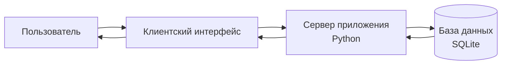

# Учёт медицинских карт пациентов

> **Краткое описание.** Проект представляет собой информационную систему для **учёта и ведения
> электронных медицинских карт пациентов** в поликлинике, амбулаторно-поликлиническом отделении,
> частной клинике или стационаре. Система заменяет бумажный документооборот, ускоряет поиск
> информации и формирует отчётность для руководства.

---

## Содержание

- [Учёт медицинских карт пациентов](#учёт-медицинских-карт-пациентов)
  - [Содержание](#содержание)
  - [О проекте](#о-проекте)
  - [Цели системы](#цели-системы)
  - [Пользователи и роли](#пользователи-и-роли)
  - [Основные функции](#основные-функции)
  - [Архитектура и стек технологий](#архитектура-и-стек-технологий)
  - [Схема работы системы](#схема-работы-системы)
  - [Структура проекта](#структура-проекта)
  - [Быстрый старт](#быстрый-старт)

---

## О проекте

**Предметная область** — учёт и ведение медицинских карт пациентов в медицинской организации.
Система должна обеспечивать:

- хранение и актуализацию электронных медицинских карт;
- учёт персональных данных пациента: *ФИО, дата рождения, пол, адрес, контакты, полис,
  паспортные данные*;
- фиксацию медицинской информации: **хронические заболевания, аллергии, диагнозы, анамнез,
  результаты осмотров, назначенное лечение, рецепты, направления, результаты лабораторных и
  инструментальных исследований, прививки, группа крови и резус-фактор**;
- ведение истории посещений и обращений.

**Решаемые проблемы:** бумажный документооборот, потеря и порча карт, медленный поиск
информации, сложность формирования отчётности.

## Цели системы

1. Перевод учёта медицинских карт в **электронный вид**.
2. Обеспечение *целостности, достоверности и доступности* данных.
3. Сокращение времени на поиск и обработку медицинской информации.
4. Формирование отчётности для руководства.

**Польза для пользователей:**

- врачи получают быстрый доступ к полной истории болезни, что снижает риск ошибок;
- регистратура ускоряет запись и оформление документов;
- руководство получает аналитику по посещаемости, заболеваемости и нагрузке;
- пациенты могут видеть свои результаты исследований.

## Пользователи и роли

| Роль | Возможности |
| :--- | :--- |
| **Пациент** | Просмотр своей медицинской карты (история посещений, диагнозы, результаты анализов и исследований), просмотр расписания, запись ко врачу |
| **Врач** | Просмотр и редактирование медицинской карты пациента, внесение диагнозов, результатов осмотров и исследований, просмотр расписания |
| **Системный администратор** | Управление пользователями, ролями и правами доступа, мониторинг системы, просмотр медицинских карт пациентов, просмотр и редактирование расписания |

## Основные функции

1. **Управление пациентами**
   - регистрация нового пациента;
   - поиск пациента (по ФИО, дате рождения, номеру карты, полису);
   - редактирование персональных данных;
   - прикрепление к врачу.

2. **Ведение электронной медицинской карты**
   - создание и просмотр электронной медицинской карты;
   - добавление записей о посещениях;
   - внесение диагнозов;
   - фиксация анамнеза и хронических заболеваний;
   - хранение результатов анализов и исследований.

3. **Работа с приёмами**
   - запись пациента на приём;
   - отметка о явке/неявке.

4. **Документооборот и печать**
   - формирование и печать выписок, справок, направлений, рецептов;
   - генерация статистических отчётов.

5. **Администрирование и безопасность**
   - управление пользователями и ролями;
   - разграничение прав доступа (*врач видит только своих пациентов*);
   - запись действий пользователей.

## Архитектура и стек технологий

Архитектура — **классическая трёхуровневая**.

| Компонент | Технология / решение |
| :--- | :--- |
| Язык разработки | **Python** |
| База данных | **SQLite** |
| Архитектура | Трёхуровневая (клиент → сервер приложения → БД) |
| Демонстрационная программа | **C++** (`myaso.cpp`) |

## Схема работы системы



## Структура проекта

```text
med-u4et/
├── README.md                  # описание проекта
├── pyproject.toml             # метаданные и настройки пакета
├── requirements.txt           # зависимости приложения
├── requirements-dev.txt       # зависимости для разработки и тестов
├── .env.example               # шаблон переменных окружения
├── .editorconfig
├── .gitignore
├── data/                      # файл базы данных SQLite (не хранится в Git)
├── docs/                      # документация проекта
│   ├── architecture.md        # архитектура и схема БД
│   ├── use-cases.md           # роли, сценарии, Use Case
│   └── images/                # схемы и диаграммы
│       ├── block-scheme-registration.png
│       ├── block-scheme-card-update.png
│       └── use-case-diagram.png
├── examples/
│   └── cpp/                   # демонстрационная программа на C++
│       ├── myaso.cpp
│       └── README.md
├── scripts/
│   ├── init_db.py             # создание схемы БД и администратора
│   └── run.py                 # запуск сервера разработки
├── src/
│   └── medcard/
│       ├── __init__.py        # фабрика приложения create_app()
│       ├── config.py          # конфигурация
│       ├── db.py              # подключение к SQLite
│       ├── models/            # доменные модели
│       ├── repositories/      # SQL-запросы к БД
│       ├── services/          # бизнес-логика
│       ├── routes/            # HTTP-маршруты (Flask blueprints)
│       ├── templates/         # Jinja-шаблоны (HTML)
│       ├── static/            # CSS и статические файлы
│       ├── utils/             # валидаторы и безопасность
│       └── sql/
│           └── schema.sql     # схема базы данных
└── tests/
    ├── conftest.py
    ├── test_app.py
    ├── test_security.py
    └── test_validators.py
```

### Назначение каталогов

| Путь | Назначение |
| :--- | :--- |
| `src/medcard/models` | Модели данных: **пользователь, пациент, медицинская карта, посещение, приём** |
| `src/medcard/repositories` | Слой доступа к данным, только SQL-запросы |
| `src/medcard/services` | Бизнес-правила: регистрация, ведение карты, расписание, отчёты |
| `src/medcard/routes` | Контроллеры Flask по доменам: `auth`, `patients`, `cards`, `schedule`, `reports`, `admin` |
| `src/medcard/templates` | HTML-представления (Jinja2) |
| `docs` | [Архитектура](docs/architecture.md), [роли и сценарии](docs/use-cases.md), блок-схемы и Use Case-диаграмма |
| `tests` | Модульные и прикладные тесты (`pytest`) |
| `examples/cpp` | Демонстрационная C++ программа `myaso.cpp` |

## Быстрый старт

```bash
python -m venv .venv
.venv\Scripts\activate          # Windows
pip install -r requirements-dev.txt

python scripts/init_db.py       # создаст data/medcard.db и администратора
python scripts/run.py           # запустит сервер на http://127.0.0.1:5000
```

Запуск тестов:

```bash
pytest
```

Демонстрационная программа на C++:

```bash
cd examples/cpp
g++ myaso.cpp -o myaso
./myaso
```

---

<p align="center"><em>Документ подготовлен на основе файла <code>u4et_medcart.docx</code>.</em></p>
